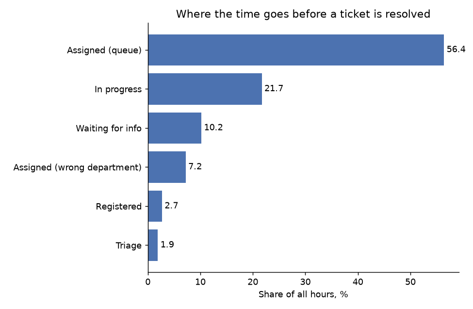
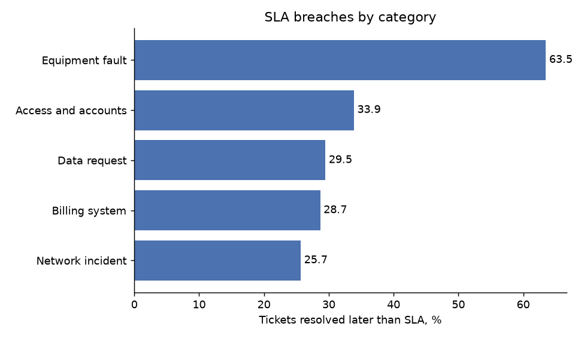
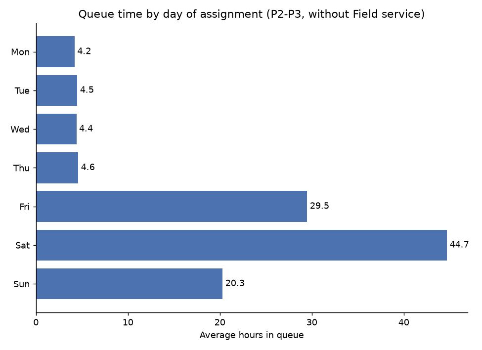

# Support Ticket Process Analysis

A business-analysis case: **35.7% of technical support tickets miss their SLA — why, and what should change?**
The project takes an event log of 6,000 tickets, reconstructs how each ticket moved between departments,
separates symptoms from causes, and ends with concrete proposals. Tools: **SQL (SQLite, window functions), Python, pandas, matplotlib.**

> **About the data.** The event log is **synthetic**: `src/generate_data.py` imitates how requests move through
> a telecom operator's technical departments and builds in several process problems for the analysis to find.
> No real company data is used, so the numbers demonstrate the method, not a real organization.

## The process

```
Registered -> Triage -> [Waiting for info] -> Assigned -> In progress -> Resolved -> Closed
                                               ^      |
                                               └──────┘  reassigned if the first department was wrong
```

Two tables: `tickets` (category, channel, priority, SLA) and `events` (one row each time a ticket enters a stage).
Time spent in a stage is the gap to the ticket's next event, computed with `LEAD()` in [`sql/00_views.sql`](sql/00_views.sql).

## Summary of findings

| # | Finding | Evidence | Cost |
|---|---|---|---|
| 1 | Field service queue is the main bottleneck | 32.1 h average wait vs 13–16 h in other departments; 63.5% of Equipment fault tickets breach SLA | 37,678 h in queue (35.5% of all queue time) |
| 2 | Handoffs before the weekend stall | P2–P3 tickets assigned Mon–Thu wait 4.2–4.6 h; assigned Fri–Sun: 20–45 h. P1 is unaffected (1.4 h every day) | — |
| 3 | "Access and accounts" tickets are routed to the wrong department | 37.2% misrouted vs 3.6–5.3% in other categories | 13,509 h in wrong queues |
| 4 | E-mail requests arrive incomplete | 45.5% of e-mail tickets wait for missing details vs 5.5% from the portal | 19,097 h waiting, 13,927 of them from e-mail |



Only 21.7% of the time before resolution is actual work. Waiting in queues takes 56.4%,
waiting for missing information 10.2%, and sitting in a wrong department 7.2%.

## How the causes were separated from the symptoms

**Symptom: SLA breaches differ by category** ([`02_sla_by_category.sql`](sql/02_sla_by_category.sql))



| Category | Tickets | SLA breached | Misrouted | Waited for info |
|---|---|---|---|---|
| Equipment fault | 1,174 | 63.5% | 3.6% | 18.2% |
| Access and accounts | 1,061 | 33.9% | 37.2% | 18.0% |
| Data request | 868 | 29.5% | 5.3% | 18.5% |
| Billing system | 1,265 | 28.7% | 5.0% | 19.7% |
| Network incident | 1,632 | 25.7% | 4.2% | 19.9% |

Two categories stand out for different reasons, so each was checked separately.

**Equipment fault → department queue** ([`05_queue_by_department.sql`](sql/05_queue_by_department.sql)).
These tickets are rarely misrouted (3.6%), so routing is not the cause. They all go to Field service,
whose queue is twice as long as any other.

**Access and accounts → misrouting** ([`03_misrouting.sql`](sql/03_misrouting.sql)).
Comparing inside the category removes the effect of the category itself:

| Access and accounts | Tickets | Avg. hours to resolve | SLA breached |
|---|---|---|---|
| Routed correctly | 666 | 23.0 | 19.5% |
| Misrouted | 395 | 46.3 | 58.2% |

Correctly routed tickets of this category are the *fastest* in the whole process. The category is not hard — it is routed badly.

**All categories → incomplete requests** ([`04_missing_info_by_channel.sql`](sql/04_missing_info_by_channel.sql)).
The share of tickets waiting for information is the same in every category (18–20%), so it was checked by intake channel instead:

| Channel | Tickets | Waited for info | SLA breached |
|---|---|---|---|
| E-mail | 1,820 | 45.5% | 42.5% |
| Phone | 1,155 | 12.6% | 33.7% |
| Portal | 3,025 | 5.5% | 32.5% |

**Weekend effect** ([`06_queue_by_weekday.sql`](sql/06_queue_by_weekday.sql)). Field service was excluded here
because its queue is long on every day and would hide the pattern.



## What is established, what needs verification

| Established from the data | Needs verification with people and documents |
|---|---|
| Field service has the longest queue | Is it understaffed, or do its tickets depend on travel and spare parts? Compare headcount and workload |
| Tickets assigned Fri–Sun wait until the next week | Do P2–P3 SLAs count calendar or working hours? If working hours, part of these breaches is a measurement issue |
| Access tickets are misrouted 7–10 times more often | Why: is there no routing rule, or is the category list ambiguous? Review 20–30 misrouted tickets with triage staff |
| E-mail requests lack required details | Which details are missing most often? Read a sample of the clarification requests |

## Proposed actions and controls

1. **Routing rule for Access and accounts.** Add an explicit rule (or a subcategory field) to the triage checklist.
   *Control:* weekly share of reassigned tickets by category, alert above 10%.
2. **Structured intake for e-mail.** Auto-reply with a link to the portal form, or a required template for e-mail requests.
   *Control:* share of tickets entering "Waiting for info" by channel.
3. **Field service capacity.** Review staffing against demand; until then, show the realistic waiting time to requesters.
   *Control:* queue age report — tickets waiting longer than 24 h, daily.
4. **Friday handoff.** A duty rota for P2 on weekends, or a Friday 15:00 triage cut-off with a Monday-morning queue review.

### Estimated effect

Removing avoidable hours from each ticket and recounting breaches ([`src/analyze.py`](src/analyze.py), `what_if`):

| Scenario | SLA breached | Avg. hours to resolve |
|---|---|---|
| Today | 35.7% | 31.3 |
| No misrouting | 32.2% | 29.1 |
| No waiting for info | 30.6% | 28.1 |
| Both fixed | 26.6% | 25.9 |

This is an upper bound: it assumes both problems disappear completely and nothing else changes.
The two fixes that need no extra staff would cut breaches by about a quarter; the rest depends on queues (findings 1 and 2).

## How to run

```bash
python -m venv .venv
.venv\Scripts\activate            # Windows;  source .venv/bin/activate on Linux/macOS
pip install -r requirements.txt

python src/generate_data.py       # creates data/tickets.csv and data/events.csv
python src/analyze.py             # runs all SQL, saves tables and charts to results/
pytest                            # checks the SQL views on a hand-made event log
```

No database installation is needed: SQLite is part of Python.

## Project structure

```
├── src/
│   ├── generate_data.py   # synthetic event log with built-in process problems
│   └── analyze.py         # loads data into SQLite, runs SQL, builds charts
├── sql/
│   ├── 00_views.sql       # stage durations with LEAD(), one-row-per-ticket view
│   └── 01 ... 06          # one question per file
├── results/               # tables (CSV) and figures
└── tests/test_views.py
```
